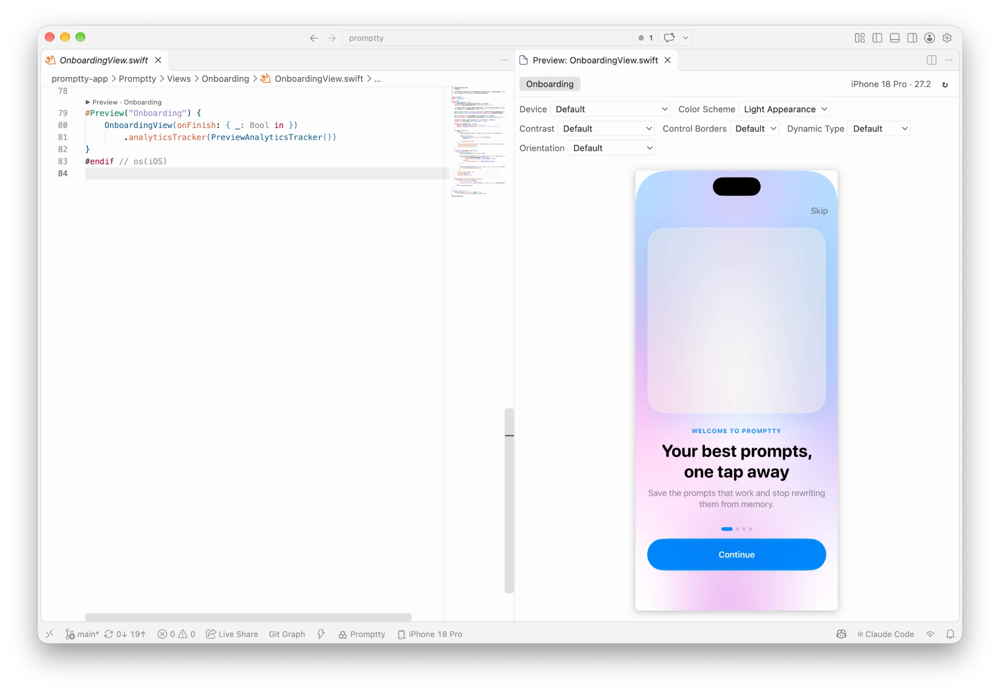

# Xcode Preview for VS Code

[](https://marketplace.visualstudio.com/items?itemName=kos-codes.xcode-preview)
[](https://marketplace.visualstudio.com/items?itemName=kos-codes.xcode-preview)
[](https://github.com/michalkos/vscode-xcode-preview/actions/workflows/ci.yml)
[](LICENSE)

SwiftUI previews in VS Code, rendered by Xcode itself.



Xcode 27 can run headless and exposes its tools over [MCP](https://modelcontextprotocol.io), including `RenderPreview`. This extension asks it to render the `#Preview` (or `PreviewProvider`) in your current Swift file and shows the image beside your editor. It re-renders when you save. Because Xcode does the rendering, the result matches Xcode's canvas, and the Xcode window never needs to be open.

## Features

- A **▶ Preview** link above each `#Preview` and `PreviewProvider` that opens that preview.
- A tab for each preview in the file. Double-click a tab to jump to its code.
- Re-renders when you save any Swift file in the workspace.
- Pick the device, language, color scheme, Dynamic Type size, orientation and the other variants Xcode offers for the preview.
- Supports `#Preview(arguments:)` items and widget timelines.
- Shows build errors as short `File.swift:12: message` lines, with the full log in the **Xcode Preview** output.
- Follows the active Swift editor.

## Install

Install **Xcode Preview** from the [VS Code Marketplace](https://marketplace.visualstudio.com/items?itemName=kos-codes.xcode-preview), or from the terminal:

```sh
code --install-extension kos-codes.xcode-preview
```

Each [GitHub release](https://github.com/michalkos/vscode-xcode-preview/releases) also has the `.vsix` attached, for installing manually.

## Requirements

- macOS with **Xcode 27 or newer**.
- Swift files that belong to an `.xcodeproj` or `.xcworkspace`. Standalone files and Swift packages without a project aren't supported, because Xcode needs the project to build the preview.

## Setup

Do this once:

1. Turn on Xcode's headless mode:

   ```sh
   sudo xcrun mcp-server enable
   ```

2. Open a Swift file and click **▶ Preview** above a preview, or the **Open Preview** button in the editor title bar. The first time, Xcode asks you to approve VS Code as an agent and your project folder. List the pending requests:

   ```sh
   xcrun mcp-server status
   ```

   Then approve each one by its id:

   ```sh
   sudo xcrun mcp-server approve <id> --always
   ```

3. Click refresh in the preview panel.

**Xcode Preview: Check Setup** shows the server's current state and these steps.

## Commands

| Command | What it does |
| --- | --- |
| Xcode Preview: Open Preview | Opens the preview panel for the current Swift file. |
| Xcode Preview: Refresh Preview | Renders the selected preview again. |
| Xcode Preview: Select Xcode Project or Workspace | Chooses the project when the folder has more than one. |
| Xcode Preview: Select Scheme | Changes the scheme Xcode builds previews with. |
| Xcode Preview: Check Setup | Shows the headless server's status and setup steps. |

## Settings

| Setting | Default | Description |
| --- | --- | --- |
| `xcodePreview.developerDir` | `""` | Xcode to use (`Xcode.app` or its `Contents/Developer`). Empty uses `xcode-select`. |
| `xcodePreview.project` | `""` | `.xcworkspace` or `.xcodeproj` to use. Empty finds the nearest one. |
| `xcodePreview.codeLens` | `true` | Show the **▶ Preview** link above each preview. |
| `xcodePreview.refreshOnSave` | `true` | Re-render when a Swift file is saved. |
| `xcodePreview.renderTimeout` | `120` | Seconds Xcode may spend building and rendering one preview. |

## How it works

The extension starts `xcrun mcpbridge`, which connects to Xcode's headless MCP server. For each render it:

1. Finds the previews in the file with a small scanner that skips comments and strings.
2. Opens the project in headless Xcode (`XcodeOpenWorkspace`).
3. Finds the file's path in the project navigator (`XcodeGlob`).
4. Calls `RenderPreview` and shows the PNG that Xcode writes.

It uses only these Xcode tools, plus `XcodeListSchemes` and `XcodeSwitchScheme` for the scheme picker. It never edits your files, changes build settings or runs `sudo`. It also has no network access: the panel's content security policy blocks all network requests.

The first render of a project is slow because Xcode builds it, which can take minutes for large projects. After that, a re-render usually takes a few seconds.

## Limitations

- **Static images:** previews aren't interactive. Xcode's headless `RenderPreview` returns an image, not a live view.
- **Saved files only:** Xcode renders what's saved on disk. Turn on VS Code's Auto Save if you want refreshes while you type.
- **One render at a time:** changes made during a render are combined into one follow-up render.

## Development

```sh
pnpm install
pnpm watch        # rebuild on change, then press F5 in VS Code to launch the extension
pnpm check        # typecheck
pnpm test         # unit tests
pnpm package      # build a .vsix
```

`pnpm render <App.xcodeproj> <File.swift> [index]` renders one preview from the terminal, without VS Code, which helps when debugging the Xcode side.

See [DEVELOPMENT.md](DEVELOPMENT.md) for running the extension locally, approvals, debugging and common problems.

## Contributing

Contributions and ideas are welcome. Read [CONTRIBUTING.md](CONTRIBUTING.md), share ideas in [Discussions](https://github.com/michalkos/vscode-xcode-preview/discussions), and report security issues privately as described in [SECURITY.md](SECURITY.md).

## License

[MIT](LICENSE)
